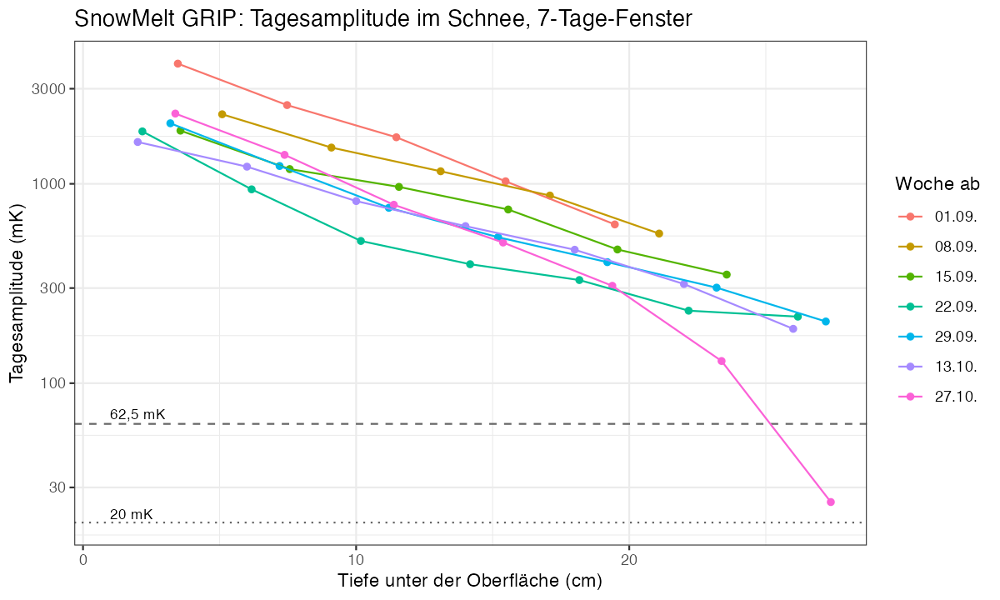
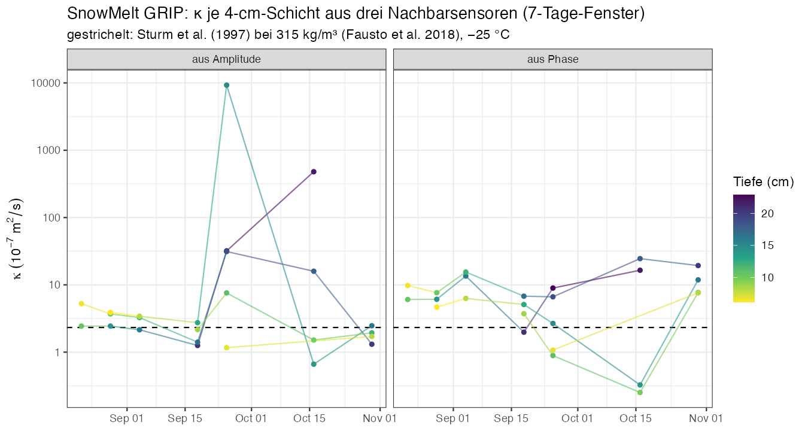

Geprüft wird, ob die Felddaten der SnowMelt-Köpfe an GRIP (IMEI 300434065508020) und Dye-3 (IMEI 301434062008160) die Zahlen aus Problemstellung (iii) und Arbeitspaket 4 des Antrags tragen. Ausgewertet sind nur eingeschneite Sensoren, das heißt mindestens 2 cm unter der Oberfläche. Die Tiefe ist die Oberflächenlage minus die Sensorhöhe. Für GRIP liefert der Verzugs-Schätzer aus `decode_snowmelt_newgrip.qmd` die Oberflächenlage, für Dye-3 der Übergang von überhöhter zu gedämpfter Tagesamplitude. An GRIP sind die Knoten 6–8 im Fenster des Tape-Experiments ausgeschnitten.

Für GRIP liegen Daten vom 10.08. bis 11.11.2026 vor. Am Ende des Zeitraums liegt die Oberfläche bei 36 cm Kettenhöhe, und acht Sensoren zwischen 4 und 32 cm Kettenhöhe sind eingeschneit. Die Fenster mit auswertbarem Tagesgang reichen bis 27 cm Tiefe. Die Telemetrie misst alle 4 h; Stundenwerte sind deshalb nicht verfügbar. Dye-3 ist erst seit dem 31.10.2026 eingeschneit, mit 3–4 Sensoren bis rund 18 cm Tiefe. Bei 8 cm Kettenhöhe fehlt dort ein Sensor, und die Tagesamplitude der Luft liegt im verfügbaren Zeitraum unter 2 K. Dye-3 ist deshalb für die Punkte 1–5 nicht prüfbar. Alle Zahlen unten beziehen sich auf GRIP.

Skripte, Rohausgabe und Tabellen liegen in `Greenland2026/analysen/2026-11-11_waermebilanz/` (`waermebilanz.R`, `ergebnis.txt`).

| Nr. | Aussage im Antrag | Ergebnis GRIP | Urteil |
|---|---|---|---|
| 1a | Krümmungsrauschen 1,5 K/m² bei 1 mK | Obergrenze ≤ 20 K/m² | nicht prüfbar |
| 1b | Krümmungsrauschen 28 K/m² bei 1/16 K | 27,7 K/m² | bestätigt |
| 2a | Dämpfungstiefe 7–11 cm | Amplitude: 9,0 cm (7,0–16,6); Phase: 13,1 cm (7,9–17,1) | Amplitude bestätigt, Spanne breiter |
| 2b | Amplitude in 50 cm Tiefe rund 20 mK | 26 mK (3–53), extrapoliert | verträglich, nicht direkt geprüft |
| 3 | Dichteindex aus κ über Sturm et al. (1997) | ρ 346 kg/m³ im Median; je Schicht und Woche Streuung 68–174 % | im Mittel bestätigt, je Schicht nicht |
| 4 | Latente Wärme aus dem Residuum; Bezug 97 W/m³ | Nachweisgrenze 60 W/m³ (Tag), 124 W/m³ (4 h) | im Tagesmittel bestätigt |
| 5a | Faktor 1,3–1,9 zwischen d_φ und d_A | 1,41 (Wochenfenster), 1,18 (3-Tage-Blöcke) | weitgehend bestätigt |
| 5b | Faktor als Indikator für Ventilation | Windabhängigkeit p = 0,12–0,20 | nicht bestätigt |

# 1 Rauschen der Profilkrümmung

**Prüfauftrag.** Rauschen der Krümmung (T[i+1] − 2T[i] + T[i−1])/Δz² bei Δz = 4 cm aus ruhigen Abschnitten bestimmen. Der Antrag nennt 1,5 K/m² bei 1 mK Rauschen. Gegenrechnung mit auf 1/16 K gerundeten Daten; der Antrag nennt 28 K/m².

**Erwartung.** Bei unabhängigem Rauschen σ_T gilt σ_c = √6 · σ_T / Δz². Für 1 mK ergibt das 1,53 K/m². Rundung auf 1/16 K wirkt wie gleichverteiltes Rauschen mit σ = 18,0 mK und ergibt 27,6 K/m².

**Ergebnis.** Die Quantisierung beträgt 0,010 mK je Count. Das entspricht 0,004 K/m² in der Krümmung und begrenzt nicht. Das Rauschen selbst ist bei 4-h-Abtastung nicht vom Signal zu trennen. Die zweite zeitliche Differenz enthält Tagesgang und Wetter und liefert deshalb nur eine Obergrenze. Sie beträgt im tiefsten Tripel σ_c ≤ 19,9 K/m² (Mitte 8 cm Kettenhöhe, z = 24 cm, KW 44). Über alle Tripel liegt der Median bei ≤ 36,5 K/m². Den Labor-Wert von 1 mK können die Felddaten weder bestätigen noch widerlegen.

Rundet man dieselben Daten auf 1/16 K, beträgt der dadurch verursachte Krümmungsfehler 27,7 K/m² (Standardabweichung, n = 2156; Median des Betrags 19,5 K/m²). Das bestätigt den Antragswert von 28 K/m².

**Zusatzbefund.** Die zeitlich gemittelte Krümmung je Tripel (15.10.–11.11.) liegt zwischen −153 und +333 K/m². Zwischen den Tripeln streut sie um 169 K/m². Darin stecken Kalibrierversätze und das tatsächliche Profil. Wäre die Streuung vollständig Versatz, entspräche das 110 mK je Sensor. Für die Wärmebilanz ist daher nur die zeitliche Änderung der Krümmung verwendbar. GRIP läuft derzeit auf den Labortabellen SM1/SM2 (66 bzw. 6 Kanäle); die Neukalibrierung steht aus. Erst sie trennt Versatz und Profil.

**Urteil.** 1b ist bestätigt. 1a ist im Feld nicht prüfbar; die Obergrenze liegt bei 20 K/m².

# 2 Tagesgang im Schnee

**Prüfauftrag.** Dämpfungstiefe aus der Amplitude und aus der Phase bestimmen; der Antrag nennt 7–11 cm. Weiter die Amplitude in 50 cm Tiefe (Antrag: rund 20 mK) und die Tiefe, ab der die Amplitude unter 62,5 mK fällt.

**Methode.** Harmonische Regression (24 h) je Sensor in 7-Tage-Fenstern, wöchentlich. Verwendet werden nur Fenster mit einer Luftamplitude von mindestens 2 K und nur Sensoren mit einer Amplitude über 30 mK. Aus der Steigung von ln A gegen z folgt d_A, aus der Steigung der Phase gegen z folgt d_φ.

**Ergebnis.** Aus sechs Wochenfenstern ergibt sich d_A = 9,0 cm (Median; Spanne 7,0–16,6 cm) und d_φ = 13,1 cm (7,9–17,1 cm). Die Amplitude bei z = 0 aus dem Fit beträgt im Median 5,4 K, die der Luft 3,85 K.

Die größte Messtiefe beträgt 27 cm; die Amplitude in 50 cm ist deshalb extrapoliert. Sie ergibt sich zu 26 mK im Median, mit einer Spanne von 3,4–53 mK. Direkt gemessen sind 25 mK in 27 cm Tiefe, im Fenster ab dem 27.10. Unter 62,5 mK fällt die Amplitude in 42 cm Tiefe (Median, 30–47 cm, ebenfalls extrapoliert).

Zur Einordnung: Bei 5 K Oberflächenamplitude ergeben d = 7 cm in 50 cm Tiefe 4 mK und d = 11 cm 53 mK. Die Antragszahl von 20 mK setzt d = 9,1 cm voraus.

{width=15cm}

**Urteil.** 2a ist für die Amplitude bestätigt (Median 9,0 cm). Die beobachtete Spanne reicht aber bis 17 cm. 2b ist mit dem Antrag verträglich, in 50 cm aber nicht gemessen.

**Vorschlag Antragstext.** „Dämpfungstiefen von 7–17 cm (Median 9 cm)“ und „in 50 cm Tiefe auf rund 25 mK abgeklungen (gemessen: 25 mK in 27 cm)“.

# 3 Temperaturleitfähigkeit je 4-cm-Schicht

**Prüfauftrag.** κ je 4-cm-Schicht aus Amplitude und Phase dreier Nachbarsensoren als Zeitreihe bestimmen. Daraus einen Dichteindex über k(ρ) nach Sturm et al. (1997) ableiten und gegen eine publizierte Oberflächendichte stellen. Dazu die Streuung von κ je Schicht und Woche.

**Methode.** Für jede Schicht dienen die beiden Nachbarsensoren (8 cm Abstand) zur Bestimmung von d_A und d_φ; daraus κ = ω d²/2. Zusätzlich wird ein komplexer Schätzer aus der Wärmeleitungsgleichung gerechnet: iωT̂ = κ T̂''. Die Inversion verwendet k(ρ) nach Sturm et al. (1997) und c_Eis(T). κ(ρ) hat bei −25 °C ein Minimum von 1,70 · 10⁻⁷ m²/s bei 207 kg/m³; invertiert wird nur auf dem Ast ρ > 207 kg/m³. Als Referenz dient Fausto et al. (2018): 315 ± 44 kg/m³ für 0–0,1 m, Grönland-Mittel aus Messungen im Frühjahr und Sommer. Das entspricht κ = 2,33 · 10⁻⁷ m²/s und d = 8,0 cm.

**Ergebnis.** Ausgewertet sind 25 Schicht-Wochen in fünf Schichten.
- κ aus der Amplitude: 2,47 · 10⁻⁷ m²/s (Median, IQR 1,71–5,25 · 10⁻⁷).
- κ aus der Phase: 6,64 · 10⁻⁷ m²/s (IQR 3,73–9,78 · 10⁻⁷).
- Komplexer Schätzer: Betrag 3,22 · 10⁻⁷ m²/s, Argument 14°.
- Das Verhältnis κ_φ/κ_A beträgt 1,8.

Als Dichteindex ergeben sich aus der Amplitude 346 kg/m³ (Median). Invertierbar sind 12 von 25 Werten; die übrigen liegen unter dem Minimum der Sturm-Kurve. Aus der Phase ergeben sich 437 kg/m³ (5 von 25 invertierbar).

Je Schicht über die Wochen beträgt der Variationskoeffizient 174 % (Amplitude) bzw. 68 % (Phase). Zwischen den Schichten innerhalb einer Woche beträgt er 31 % bzw. 47 %. Die Ausreißer der Amplitudenschätzung Ende September (Abbildung) entstehen, wenn das Amplitudenverhältnis zweier Nachbarn nahe 1 liegt.

{width=15cm}

**Urteil.** Im Median über Schichten und Wochen ist der Dichteindex aus der Amplitude (346 kg/m³) mit Fausto et al. (2018) verträglich (315 ± 44 kg/m³). Je Schicht und Woche ist er bei einer Streuung von 68–174 % nicht belastbar. Der Weg über die Phase ergibt um den Faktor 1,8 höhere κ (siehe Punkt 5).

# 4 Residuum der Wärmeleitungsgleichung

**Prüfauftrag.** Residuum ρc ∂T/∂t − ∂z(k ∂T/∂z) in W/m³ bestimmen und die Nachweisgrenze je Schicht für Stunden- und Tagesmittel angeben. Bezug: Wiedergefrieren von 1 mm Wasser pro Tag in 4 cm entspricht 97 W/m³. Ereignisse über der Nachweisgrenze auflisten.

**Methode.** Je Schicht wird die Regression ∂T/∂t = a + κ · T'' angesetzt; der Konstantterm a nimmt den Kalibrierversatz der Krümmung auf. Das Residuum wird mit ρc multipliziert, mit ρ = 315 kg/m³ und c = c_Eis(T). Als Nachweisgrenze gilt das Dreifache der robusten Standardabweichung (MAD). Statt Stundenwerten gehen 4-h-Werte ein, weil die Telemetrie nicht dichter misst.

**Ergebnis.** Bei 4-h-Werten liegt die Nachweisgrenze bei 124 W/m³ (Median; je Schicht 88–385 W/m³), bei Tagesmitteln bei 60 W/m³ (54–79 W/m³). Das gefittete κ beträgt 1,8 · 10⁻⁷ m²/s (4 h) bzw. 7,3 · 10⁻⁸ m²/s (Tag). Der Versatzterm liegt bei −0,2 bzw. 1,2 W/m³.

In den Tagesmitteln überschreitet kein Wert die Nachweisgrenze (0 von 342; Maximum 53 W/m³). Bei den 4-h-Werten liegen 19 von 2134 darüber. Alle 19 fallen auf den 15.–18.08., tagsüber zwischen 10 und 18 UTC, in der Schicht bei 8 cm Kettenhöhe (z = 6–9 cm). Die Residuen liegen zwischen +107 und +229 W/m³ bei Temperaturen von −21 bis −3 °C. Ein Phasenwechsel ist bei diesen Temperaturen ausgeschlossen. Vereinbar ist das mit absorbierter Kurzwelle in den obersten Zentimetern, die das Diffusionsmodell nicht enthält. Die höchste Temperatur im Schnee im gesamten Zeitraum beträgt −0,9 °C; ein Schmelzereignis liegt nicht vor.

**Urteil.** Im Tagesmittel ist der Nachweis von 97 W/m³ (1 mm/Tag) bestätigt; die Grenze entspricht etwa 0,6 mm/Tag. Bei 4-h-Werten ist er nicht gegeben. Stundenwerte sind mit der Telemetrie nicht prüfbar; die Logger-Rohdaten wären dafür nötig. Ein Test an einem echten Schmelz- oder Wiedergefrierereignis fehlt, weil keines eingetreten ist. Eindringende Strahlung erzeugt in den obersten 10 cm Residuen derselben Größe und muss im Datenprodukt getrennt werden.

# 5 Faktor zwischen den Abklinglängen aus Amplitude und Phase

**Prüfauftrag.** Hängt der Faktor 1,3–1,9 zwischen d_φ und d_A von der Windgeschwindigkeit (AWS Summit bzw. NASA-SE, GEUS-THREDDS) und von der Einstrahlung ab? Hängt er vom Wind ab, stützt das die Deutung als Ventilation.

**Methode.** d_A und d_φ werden in nicht überlappenden 3-Tage-Blöcken bestimmt, nur bei einer Luftamplitude von mindestens 2 K. Wind (wspd_u) und Einstrahlung (dsr) sind Tagesmittel der Summit-AWS über denselben Block. Ausgewertet werden eine lineare Regression des Faktors auf beide Größen und Rangkorrelationen.

**Ergebnis.** In 18 Blöcken beträgt der Faktor 1,18 (Median; Spanne 0,56–2,30); in den Wochenfenstern von Punkt 2 sind es 1,41 (0,48–2,46). Der Wind lag zwischen 1,9 und 8,8 m/s.

Regression:
- Wind: +0,091 ± 0,067 pro m/s, p = 0,20;
- Einstrahlung: +0,0008 ± 0,0015 pro W/m², p = 0,63.

Rangkorrelationen:
- mit dem Wind ρ = 0,38 (p = 0,12);
- mit der Einstrahlung ρ = 0,16 (p = 0,53).

Einen zeitlichen Trend zeigt der Faktor nicht (ρ = −0,09).

**Urteil.** Der Faktor liegt mit 1,2–1,4 am unteren Rand des Antragswerts (5a). Eine Windabhängigkeit ist bei n = 18 nicht nachweisbar (5b). Das Vorzeichen ist positiv; bei einer Effektgröße von 0,09 pro m/s wären rund 40 Blöcke nötig, um p < 0,05 zu erreichen.

**Vorschlag Antragstext AP 4.** Den Faktor als Prüfgröße für Ventilation und Dampftransport einführen, nicht als Indikator. Der Test erfolgt an Messreihen über einen Winter mit Wind über 10 m/s.

# Offene Punkte

- Neukalibrierung GRIP. Danach die Punkte 1 (Zusatzbefund) und 4 neu rechnen (`extrahiere.R`, dann `waermebilanz.R`).
- Dye-3 erneut prüfen, sobald mindestens fünf Sensoren mindestens zwei Wochen eingeschneit sind. Mit der Polarnacht fehlt dort allerdings der Tagesgang; Punkte 2, 3 und 5 bleiben dann ohne Daten bis zum Frühjahr 2027.
- Kohnen B50, 2-m-Schacht (0,2–2,25 m, kalibriert, Registry `kohnen2526`). Die SD-Kartendaten von Nora Hirsch würden die Amplitude in 0,4–0,6 m direkt messen. Die Telemetrie (09 und 21 UTC) reicht dafür nicht. Der Pfad zu den Daten ist noch offen.

# Literatur

Fausto, R. S., Box, J. E., Vandecrux, B., et al. (2018): A snow density dataset for improving surface boundary conditions in Greenland ice sheet firn modeling, Front. Earth Sci., 6, 51, doi:10.3389/feart.2018.00051.

Sturm, M., et al. (1997): The thermal conductivity of seasonal snow, J. Glaciol., 43, 26–41, doi:10.3189/S0022143000002781.
